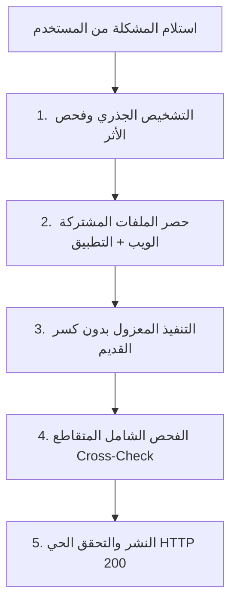

# دليل وبروتوكول حل المشكلات البرمجية ومنع الانحدار (Zero-Regression Playbook)
## منصة رِفْق (RFQSA) — موقع الويب وتطبيق الأندرويد والباك إند

> **الهدف الأساسي**: حل أي مشكلة برمجية تُطلب من المستخدم بدقة متناهية، مع **ضمان 100% بعدم تأثر باقي الأكواد البرمجية وعدم ظهور أي أخطاء جانبية (Zero Regressions)**.

---

## 📌 المبادئ الذهبية الحاكمة (Core Engineering Rules)

1. **مبدأ "المصدر الوحيد للحقيقة" (Single Source of Truth - SSOT)**:
   - العمليات الحسابية الحساسة (الضريبة، العمولة، رسوم التوصيل، الإجمالي، رصيد المحفظة) يجب أن تصدر من السيرفر (Backend API).
   - الواجهات (الموقع وتطبيق الأندرويد) تعرض نفس الأرقام ولا تخترع حسابات مستقلة.

2. **مبدأ التعديل المعزول (Blast Radius Containment)**:
   - قبل تعديل أي دالة أو مكون مشترك (`Shared Widget` أو `Helper Function`)، يجب فحص جميع الملفات التي تستدعيه لحصر أثر التغيير بدقة.

3. **مبدأ التوافق العكسي (Backward Compatibility)**:
   - التعديلات الجديدة لا يجوز أبداً أن تكسر البيانات التاريخية أو السجلات القديمة المخزنة في قواعد البيانات (`orders_db.json` و `invoices_db.json`).

4. **مبدأ التعديل التراكمي الإضافي (Additive Changes)**:
   - عند توسيع وظيفة دالة، تُضاف المعاملات الجديدة كمعاملات اختيارية (`Optional Parameters`) بقيم افتراضية تحافظ على السلوك القديم لمن لم يمررها.

---

## 🔄 بروتوكول الخطوات الخمس الإلزامي عند حل أي مشكلة

كل مشكلة يرسلها المستخدم تخضع لهذا المسار الإجباري:

---

### الخطوة 1: التشخيص الجذري وحصر نطاق الأثر (Diagnosis & Blast Radius)
* **المطلوب**: معرفة السبب الجذري الحقيقي للمشكلة بدلاً من "ترقيع" العَرَض الخارجي.
* **إجراء إلزامي**:
  - البحث الفوري عن الدالة أو المتغير في كامل مجلدات المشروع (`mobile_app/` و `app/` و `lib/`).
  - الإجابة عن السؤال: *"إذا قمت بتعديل هذا السطر، ما هي الشاشات أو العمليات الأخرى التي ستتأثر؟"*

---

### الخطوة 2: مراجعة التزامن بين الويب والتطبيق (Web & Mobile Parity)
* أي خاصية لها واجهتان (ويب + جوال)، يجب فحص الاثنين معاً:
  - **حسابات الأسعار والضرائب**: التأكد من تطابق ناتج المعادلة في الموقع مع تطبيق الأندرويد هللاً بهللة.
  - **طريقة الاستلام**: التأكد من أن "استلام من الفرع" و "توصيل" يُعاملان بنفس الشروط في كل الشاشات.
  - **عرض الصور والمرفقات**: التأكد من أن المسار يعمل عبر متصفح الويب وعبر مشغل الصور في فلاتر بنفس كفاءة الاتصال.

---

### الخطوة 3: التنفيذ الآمن والمعزول (Safe & Isolated Implementation)
* التعديل فقط على الأسطر المتعلقة بالمشكلة دون إعادة صياغة ملفات كاملة دون مبرر.
* الحفاظ التام على التعليقات والوثائق والدوال القائمة.
* عدم تغيير أسماء الحقول الأساسية في الـ JSON أو الـ API، وفي حال الحاجة لحقل جديد يُضاف كحقل إضافي مكمل.

---

### الخطوة 4: فحص الانحدار الصارم (Regression Testing Checklist)
قبل اعتبار المشكلة منتهية، يتم التحقق الإلزامي من القائمة التالية:
- [ ] **الفواتير القديمة والجديدة**: هل مجموع البنود الفردية + الرسوم + الضريبة = الإجمالي النهائي تماماً؟
- [ ] **الخيارات المزدوجة (أصلي / تجاري)**: هل التبديل بينهما يعيد الحساب الصحيح ويخفي/يظهر بيانات الماركة بدقة؟
- [ ] **المحفظة والرصيد**: هل عملية الخصم مطابقة للمبلغ الإجمالي الفعلي؟
- [ ] **واجهة المستخدم وتنسيق النصوص**: هل النصوص والأيقونات داخل حدود الحاويات دون أي خروج أو تداخل بصري (No Overflow)؟
- [ ] **الصور والملفات**: هل كل الصور تفتح بدون أي أيقونة مكسورة؟

---

### الخطوة 5: النشر والتحقق الحي المباشر (Deployment & Verification)
- رفع التعديلات ومزامنة ملفات الويب والخادم فورياً.
- بناء حزمة التطبيق `APK Release` ونشرها في مسارها العام `/var/www/rfq/public/rfq.apk`.
- تنفيذ فحص شبكي فوري (`HTTP HEAD/GET`) للتأكد من استجابة الموقع برمز **200 OK** وسلامة الحزمة.

---

## 🧮 القواعد الحسابية والمالية الصارمة للمنظومة (وفق لوائح ZATCA)

| البند | القاعدة المعتمدة |
| :--- | :--- |
| **قيمة القطع (Subtotal)** | مجموع أسعار القطع المقبولة فقط مضروبة في كمياتها (بعد خصم كوبون السلة إن وُجد). |
| **عمولة المنصة للعميل** | نسبة مئوية محددة من إدارة المنصة (افتراضياً 5%) تُحسب من قيمة القطع المقبولة. |
| **رسوم التوصيل** | مجاناً (0.00 ر.س) في حال الاستلام من الفرع، أو القيمة المقررة (25 ر.س افتراضياً) عند اختيار التوصيل. |
| **الإجمالي قبل الضريبة** | `قيمة القطع بعد الخصم + عمولة المنصة + رسوم التوصيل الفعلية`. |
| **ضريبة القيمة المضافة (15%)** | 15% على كامل وعاء التوريد الخاضع للضريبة (`الإجمالي قبل الضريبة × 0.15`). |
| **الإجمالي النهائي المستحق** | `الإجمالي قبل الضريبة + ضريبة القيمة المضافة` (تطابق حسابي 100%). |

---

## 📝 دليل المستخدم لصياغة أي طلب أو مشكلة مستقبلاً (User Reporting Guide)

لضمان حل مشكلتك بأعلى سرعة وبصفر أخطاء، يُفضّل ذكر الآتي عند مراسلتي:
1. **أين تظهر المشكلة؟** (تطبيق الأندرويد، الموقع، لوحة المورد، لوحة العميل، أو في الفواتير).
2. **رقم الطلب أو الفاتورة أو السيارة** إن وُجدت (مثال: طلب `#6684`).
3. **صورة شاشة توضيحية** (لقطة الشاشة تساعد فوراً في رصد التنسيق وتحديد الكود المسؤول).
4. **النتيجة المتوقعة** (ما هو الشكل أو الرقم الصحيح الذي ترغب في اعتماده).

---

> **تعهد المنظومة**: هذا الملف يُعد مرجعاً تعاقدياً صارماً يُلزم المساعد البرمجي بفحص الأثر المتقاطع وحماية كامل الأكواد القائمة مع كل مشكلة تُطرح.
